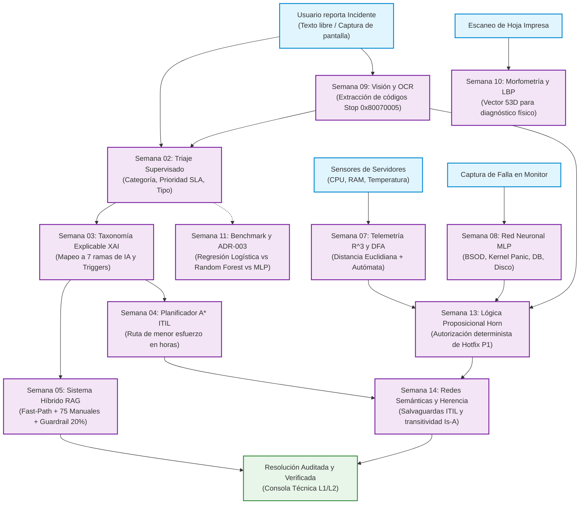
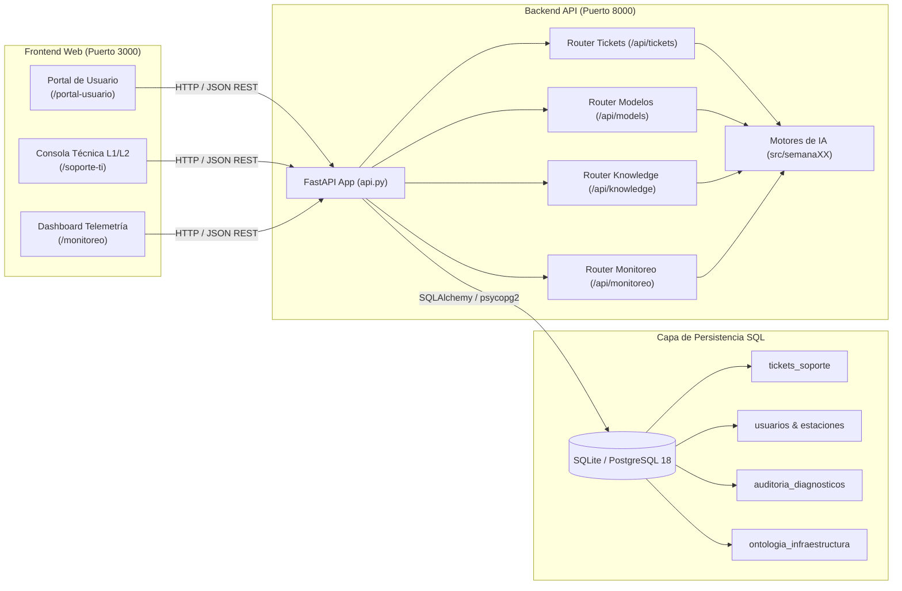

# ServiceDesk AI Enterprise - Asistente Inteligente de Soporte TI e Infraestructura

[](https://www.python.org/)
[](https://fastapi.tiangolo.com/)
[](https://nodejs.org/)
[](https://expressjs.com/)
[](https://scikit-learn.org/)
[](https://www.axelos.com/)
[](tests/)

Sistema integral de **Inteligencia Artificial aplicada a la Mesa de Ayuda y Operaciones de Infraestructura TI**. El proyecto combina de manera sinérgica múltiples paradigmas de IA (aprendizaje supervisado, sistemas simbólicos y explicables XAI, búsqueda heurística en grafos, recuperación RAG, redes neuronales, visión por computador, lógica formal de Horn y redes semánticas jerárquicas) para automatizar el ciclo de vida completo de incidentes y requerimientos técnicos en centros de datos corporativos.

---

## 1. Visión General y Propósito del Proyecto

En las mesas de ayuda corporativas (IT Service Desk), los analistas de Nivel 1 (L1) y Nivel 2 (L2) enfrentan a diario cientos de tickets con descripciones ambiguas, capturas de error en imágenes no estructuradas y fallas intermitentes de red o hardware. Resolver estos incidentes manualmente genera:
1. **Cuellos de botella en el triaje:** Demoras de minutos clasificando la categoría, prioridad y urgencia de cada ticket.
2. **Alucinaciones o errores de procedimiento:** Aplicación de comandos erróneos en servidores de producción sin consultar los manuales homologados.
3. **Falta de explicabilidad y auditoría:** Dificultad para justificar ante auditores de normas ITIL por qué se autorizó un cambio crítico o por qué se eligió una ruta de escalamiento.

**ServiceDesk AI** resuelve estos desafíos integrando **11 semanas de fundamentos de Inteligencia Artificial**, organizadas de manera modular y didáctica para que cada módulo atienda una necesidad concreta de la operación técnica:



---

## 2. Tabla Síntesis de Módulos por Semanas

| Semana | Técnica de Inteligencia Artificial | Rol en la Mesa de Ayuda TI | Script Ejecutable | Reporte Técnico |
|:---:|---|---|---|:---:|
| **S02** | **Machine Learning Supervisado Multietiqueta** (TF-IDF + `LogisticRegression` con `MultiOutputClassifier`) | Triaje automático instantáneo de tickets: predice categoría, prioridad/SLA y si es incidente o requerimiento. | [`src/semana02_fundamentos.py`](src/semana02_fundamentos.py) | [Reporte S02](reports/semana02.md) |
| **S03** | **Taxonomía Explicable (XAI) y Motor Simbólico** (Reglas declarativas con catálogo de 123 activadores léxicos) | Mapeo determinista y auditable del problema hacia 7 disciplinas de IA recomendando la técnica de resolución. | [`src/semana03_taxonomia.py`](src/semana03_taxonomia.py) | [Reporte S03](reports/semana03.md) |
| **S04** | **Búsqueda Heurística Informada ($A^*$) y Adversarial (Minimax)** (Grafo ITIL con $f(n)=g(n)+h(n)$ y teoría de juegos) | Planifica la secuencia de menor costo/horas de trabajo técnico y analiza la naturaleza de fallas frente a juegos. | [`src/semana04_astar.py`](src/semana04_astar.py)<br>[`src/semana04_minimax.py`](src/semana04_minimax.py) | [Reporte S04](reports/semana04.md) |
| **S05** | **Sistema Híbrido RAG con Guardrail Anti-Alucinación** (Reglas Fast-Path + TF-IDF/Coseno + Filtro de contención al 20%) | Recupera manuales técnicos homologados (75 artículos) y bloquea solicitudes fuera de alcance sin alucinar comandos. | [`src/semana05_sistema_hibrido.py`](src/semana05_sistema_hibrido.py) | [Reporte S05](reports/semana05.md) |
| **S07** | **Representaciones del Conocimiento y Telemetría** (Espacio vectorial $\mathbb{R}^3$, lógica de hechos y autómata DFA) | Monitoreo de salud de servidores en tiempo real, detección de distancias de anomalía y secuencias críticas de alarma. | [`src/semana07_representaciones.py`](src/semana07_representaciones.py) | [Reporte S07](reports/semana07.md) |
| **S08** | **Redes Neuronales (MLP) y Ontología Semántica** (Perceptrón Multicapa + SQLite + Grafo NetworkX / GraphML) | Clasificación de capturas de pantallas de error de monitor y vinculación relacional con la topología de la empresa. | [`src/semana08_red_ontologia.py`](src/semana08_red_ontologia.py) | [Reporte S08](reports/semana08.md) |
| **S09** | **Visión por Computador y Extracción OCR** (Filtro Canny, segmentación Otsu, componentes conexos y Tesseract OCR) | Procesamiento digital de capturas para extraer automáticamente códigos de parada (ej. `0x80070005`) sin tipeo manual. | [`src/semana09_vision.py`](src/semana09_vision.py) | [Reporte S09](reports/semana09.md) |
| **S10** | **Análisis de Texturas y Morfometría LBP** (Vector compacto de 53 dimensiones: morfometría + histograma + LBP) | Detección de fallas mecánicas en periféricos de impresión escaneados mediante distancia euclidiana vs patrón óptimo. | [`src/semana10_texturas.py`](src/semana10_texturas.py) | [Reporte S10](reports/semana10.md) |
| **S11** | **Benchmark Experimental y Registro de Decisión (ADR-003)** (Comparativa multi-corrida: Logistic Regression vs Random Forest vs MLP) | Certificación empírica del modelo óptimo de triaje para producción evaluando tiempos, exactitud (>98%) y latencia. | [`src/semana11_benchmark.py`](src/semana11_benchmark.py) | [Reporte S11](reports/semana11.md) |
| **S13** | **Lógica Proposicional y Reglas de Horn ITIL** (Encadenamiento hacia adelante *Forward Chaining* y Mundo Abierto) | Inferencia lógica formal con certeza 100% demostrada para autorizar despliegues de hotfix y pases de emergencia P1. | [`src/semana13_conocimientos.py`](src/semana13_conocimientos.py) | [Reporte S13](reports/semana13.md) |
| **S14** | **Redes Semánticas y Herencia Jerárquica ITIL** (Grafos dirigidos, normalización Unicode NFD y transitividad *Is-A*) | Deducción automática de dependencias y salvaguardas obligatorias heredadas (UPS, backup inmutable) en activos TI. | [`src/semana14_redes_semanticas.py`](src/semana14_redes_semanticas.py) | [Reporte S14](reports/semana14.md) |

---

## 3. Detalle Didáctico Semana a Semana

A continuación se detalla de forma clara y sencilla el problema real que resuelve cada semana, cómo opera internamente su técnica de Inteligencia Artificial y el comando exacto para probarla.

---

### Semana 02: Fundamentos de IA y Triaje Supervisado Multietiqueta

* **¿Qué problema resuelve?**  
  Cuando un usuario reporta un problema ("No puedo acceder a la VPN desde mi casa"), un operador humano debe decidir manualmente tres cosas: a qué área técnica enviarlo, qué tan urgente es y si es una falla operativa o un trámite administrativo. En una empresa con miles de casos, esto causa demoras y errores de enrutamiento.

* **¿Cómo funciona la IA?**  
  Se implementa un pipeline de aprendizaje automático supervisado en Scikit-Learn:
  1. **Vectorización TF-IDF con limpieza Unicode:** Convierte las palabras del texto en números ponderando su frecuencia relativa e importancia semántica.
  2. **Clasificador Multisalida (`MultiOutputClassifier`):** Entrena tres estimadores lineales independientes (`LogisticRegression`) dentro de un único pipeline serializable.
  3. **Predicción atómica tridimensional:** En una fracción de milisegundo produce:
     * **Categoría técnica:** `hardware`, `software`, `red` o `accesos`.
     * **Nivel de prioridad:** `alta`, `media` o `baja` (según los acuerdos de nivel de servicio SLA).
     * **Tipo de caso:** `sí` (incidente que detiene la operación) o `no` (requerimiento rutinario).

* **Entrada y Salida:**  
  * *Entrada:* `"Se cayó el switch central del piso 3, ningún equipo tiene conexión ni salida a internet"`  
  * *Salida:* Categoría: `red` | Prioridad: `alta` | Incidente: `sí` (Accuracy global > 98% sobre 1.000 tickets).

* **Comando para ejecutar:**
  ```bash
  python src/semana02_fundamentos.py
  ```
* **Recursos:** Código en [`src/semana02_fundamentos.py`](src/semana02_fundamentos.py) | Reporte completo en [`reports/semana02.md`](reports/semana02.md).

---

### Semana 03: Taxonomía Explicable (XAI) y Motor Simbólico

* **¿Qué problema resuelve?**  
  Los modelos estadísticos de Machine Learning actúan muchas veces como "cajas negras": asignan una etiqueta pero no pueden justificar por qué lo hicieron. Para auditorías de calidad y para saber qué herramienta tecnológica aplicar, se necesita explicabilidad total (*Explainable AI - XAI*).

* **¿Cómo funciona la IA?**  
  Se utiliza un motor simbólico determinista basado en conocimiento estructurado:
  1. **Catálogo de activadores léxicos:** Archivo declarativo externo ([`data/activadores_taxonomia.json`](data/activadores_taxonomia.json)) con 123 términos técnicos distribuidos en 7 ramas de IA.
  2. **Escaneo léxico y conteo de activadores:** Normaliza el texto y detecta qué palabras clave aparecen en el requerimiento.
  3. **Resolución jerárquica de disciplinas:** Mapea el problema a una de las **7 disciplinas de IA**:
     * *Procesamiento de Lenguaje Natural (PLN)*
     * *Visión por Computador*
     * *Aprendizaje Predictivo*
     * *Sistemas de Recomendación*
     * *Sistemas Expertos*
     * *IA Generativa*
     * *Robótica y Automatización (RPA)*
  4. **Salida auditable:** Entrega una cuádrupla estructurada con la categoría primaria, áreas secundarias detectadas, lista exacta de activadores disparados y técnica sugerida de solución.

* **Comando para ejecutar:**
  ```bash
  python src/semana03_taxonomia.py
  ```
* **Recursos:** Código en [`src/semana03_taxonomia.py`](src/semana03_taxonomia.py) | Reporte completo en [`reports/semana03.md`](reports/semana03.md).

---

### Semana 04: Búsqueda Heurística Informada ($A^*$) y Adversarial (Minimax)

* **¿Qué problema resuelve?**  
  Resolver un incidente técnico complejo implica tomar decisiones secuenciales (revisar manuales, reiniciar un servicio, ajustar configuraciones, revertir cambios o escalar a un especialista Nivel 3). Cada acción tiene un costo en horas de ingeniería. ¿Cuál es el camino que resuelve el problema en el menor tiempo posible?

* **¿Cómo funciona la IA?**  
  1. **Algoritmo $A^*$ sobre Grafo ITIL:** Modela el ciclo de vida de un incidente como un grafo de 11 estados y 16 transiciones dirigidas. Evalúa cada estado con la fórmula matemática:
     $$f(n) = g(n) + h(n)$$
     donde $g(n)$ es el esfuerzo real acumulado en horas y $h(n)$ es una heurística admisible y monótona/consistente ($h(u) \le c(u, v) + h(v)$) que garantiza matemáticamente encontrar la ruta de menor costo sin evaluar estados innecesarios.
  2. **Bloqueo condicional dinámico:** Si no existen respaldos o la base de conocimiento está desactualizada, el algoritmo descarta automáticamente esas ramas y encuentra la ruta alternativa óptima.
  3. **Búsqueda Adversarial (Minimax):** Implementa el árbol de decisión minimax en un entorno formal (tres en línea) para ilustrar la diferencia teórica: mientras que en un juego hay un contrincante que busca minimizar nuestra ganancia, en la infraestructura de TI los fallos son estocásticos o cooperativos.

* **Comando para ejecutar:**
  ```bash
  python src/semana04_astar.py
  python src/semana04_minimax.py
  ```
* **Recursos:** Código en [`src/semana04_astar.py`](src/semana04_astar.py) y [`src/semana04_minimax.py`](src/semana04_minimax.py) | Reporte completo en [`reports/semana04.md`](reports/semana04.md).

---

### Semana 05: Sistema Híbrido RAG Explicable con Guardrails Anti-Alucinación

* **¿Qué problema resuelve?**  
  Si un modelo de lenguaje masivo (LLM) inventa un comando de terminal peligroso (como un borrado masivo de base de datos) o sugiere una solución irrelevante para una consulta ajena a TI, se compromete la infraestructura. Se requiere un sistema de recuperación documental preciso y con control estricto de alucinaciones.

* **¿Cómo funciona la IA?**  
  Combina cuatro capas de decisión coordinadas:
  1. **Fast-Path determinista:** Reglas expertas para problemas comunes con respuesta instantánea en 0 ms (ej. recalentamiento de CPU).
  2. **Recuperación Aumentada por Generación (RAG):** Sobre una base formal de **75 manuales procedimentales homologados** ([`data/base_conocimiento.txt`](data/base_conocimiento.txt)), vectoriza la consulta con TF-IDF (filtrando 56 stop words en español) y calcula la **similitud coseno**:
     $$\text{sim}(\vec{q}, \vec{d}) = \frac{\vec{q} \cdot \vec{d}}{\|\vec{q}\| \|\vec{d}\|}$$
  3. **Validador supervisado:** Confirma que la categoría del manual coincida con el dominio del problema.
  4. **Guardrail de contención al 20%:** Si la similitud coseno máxima es inferior a `0.20`, el sistema determina que la solicitud está fuera de catálogo (por ejemplo: "se descompuso la cafetera") y desvía el caso a contención sin emitir comandos erróneos.

* **Comando para ejecutar:**
  ```bash
  python src/semana05_sistema_hibrido.py
  ```
* **Recursos:** Código en [`src/semana05_sistema_hibrido.py`](src/semana05_sistema_hibrido.py) | Reporte completo en [`reports/semana05.md`](reports/semana05.md).

---

### Semana 07: Representaciones del Conocimiento, Telemetría en $\mathbb{R}^3$ y Autómata DFA

* **¿Qué problema resuelve?**  
  "Reconocer exige representar". Un computador no toca servidores físicos; interpreta representaciones numéricas, simbólicas o de estados temporales para detectar caídas antes de que los usuarios las noten.

* **¿Cómo funciona la IA?**  
  Implementa las tres formas canónicas de representación del conocimiento:
  1. **Representación Numérica en $\mathbb{R}^3$:** Modela lecturas de hardware continuas como un vector:
     $$\vec{x} = [\text{Temperatura } (°\text{C}), \text{Carga CPU } (\%), \text{Tasa de errores/min}]$$
     Calcula la distancia euclidiana ($L_2$) frente al vector de referencia saludable según el SLA corporativo:
     $$\text{Distancia} = \|\vec{x} - \vec{x}_{\text{ref}}\| = \sqrt{\sum (x_i - x_{\text{ref}, i})^2}$$
  2. **Representación Simbólica:** Evalúa conjuntos de hechos cualitativos (`facts`) mediante reglas lógicas de producción (`.issubset()`), permitiendo explicar el diagnóstico con palabras humanas.
  3. **Autómata Finito Determinista (DFA):** Modela la dinámica temporal de eventos en trazas de logs para reconocer secuencias críticas de alarma (patrón `'01'`) que anuncian un fallo inminente.
  4. **Transductor Híbrido:** Puente sensorial que traduce lecturas continuas a hechos discretos según umbrales de SLA.

* **Comando para ejecutar:**
  ```bash
  python src/semana07_representaciones.py
  ```
* **Recursos:** Código en [`src/semana07_representaciones.py`](src/semana07_representaciones.py) | Reporte completo en [`reports/semana07.md`](reports/semana07.md).

---

### Semana 08: Redes Neuronales (MLP) y Ontología Semántica de Infraestructura

* **¿Qué problema resuelve?**  
  Muchos usuarios no saben explicar su problema y solo envían una foto de su pantalla con un pantallazo azul (BSOD) o un cuadro de error. El sistema debe clasificar esa imagen y vincularla con la arquitectura de servidores de la organización.

* **¿Cómo funciona la IA?**  
  1. **Red Neuronal Perceptrón Multicapa (MLP):** Red artificial entrenada sobre imágenes de fallas técnicas redimensionadas a 32x32 píxeles (vectores densos de 1.024 dimensiones), clasificando en cuatro tipos de fallos:
     * *BSOD (Pantalla Azul de Windows)*
     * *Kernel Panic (Fallo de núcleo Linux)*
     * *Database Error (Caída de base de datos)*
     * *Disk Full (Almacenamiento saturado)*
  2. **Persistencia Relacional en SQLite:** Registra cada imagen procesada, su clase predicha y su evidencia de auditoría.
  3. **Ontología Semántica en Grafos (GraphML/NetworkX):** Vincula el tipo de error visual detectado con los Elementos de Configuración de la empresa (servidores web, gestores de base de datos PostgreSQL, clústeres de almacenamiento) y exporta el grafo de conocimiento para navegación semántica.

* **Comando para ejecutar:**
  ```bash
  python src/semana08_red_ontologia.py
  ```
* **Recursos:** Código en [`src/semana08_red_ontologia.py`](src/semana08_red_ontologia.py) | Reporte completo en [`reports/semana08.md`](reports/semana08.md).

---

### Semana 09: Visión por Computador, Segmentación ROI y Extracción OCR

* **¿Qué problema resuelve?**  
  Los códigos hexadecimales de detención de Windows o Linux (como `0x80070005` o `0x0000007B`) son propensos a errores de tipeo cuando los analistas los transcriben manualmente. Se requiere aislar el texto dentro de la imagen de forma automática.

* **¿Cómo funciona la IA?**  
  Pipeline determinista de Procesamiento Digital de Imágenes (PDI) sobre la captura oficial [`data/imagen_proyecto.png`](data/imagen_proyecto.png) ($800 \times 420$ px):
  1. **Conversión y normalización:** Pasa la imagen RGB a escala de grises flotante en $[0.0, 1.0]$.
  2. **Detección de bordes con operador Canny:** Aplica gradientes con dispersión gaussiana calibrada en $\sigma = 2.0$.
  3. **Umbralización adaptativa bimodal de Otsu:** Calcula el umbral óptimo global ($T^* = 0.5783$) e invierte la polaridad para aislar los caracteres tipográficos del fondo.
  4. **Análisis morfológico y componentes conexos:** Identifica 695 regiones conexas (`measure.label`) y filtra cajas delimitadoras (*bounding boxes*).
  5. **Aislamiento de ROI y OCR con Tesseract:** Extrae el código de error `0x80070005 - ACCESO DENEGADO / TIMEOUT` y despacha el payload estructurado a los módulos de RAG (S05) y Planificación $A^*$ (S04).

* **Comando para ejecutar:**
  ```bash
  python src/semana09_vision.py
  ```
* **Recursos:** Código en [`src/semana09_vision.py`](src/semana09_vision.py) | Reporte completo en [`reports/semana09.md`](reports/semana09.md).

---

### Semana 10: Análisis de Texturas, Morfometría y LBP para Periféricos de Hardware

* **¿Qué problema resuelve?**  
  En las oficinas corporativas, las impresoras láser y multifuncionales fallan continuamente. Los usuarios reportan "la hoja sale manchada" o "salen rayas", y los técnicos cambian piezas caras a ciegas. Se necesita un método de control de calidad objetivo que identifique qué pieza mecánica está desgastada a partir del escaneo de la hoja impresa.

* **¿Cómo funciona la IA?**  
  Analiza escaneos de hojas de prueba y extrae un **vector compacto de 53 características numéricas**, invariante a rotación e iluminación:
  1. **3 características morfométricas conexas:** Número de regiones de tóner anómalas, área media y relación de aspecto mediante Otsu inteligente con polaridad por luminancia media.
  2. **32 bins de histograma fotométrico:** Distribución de niveles de gris normalizada que mide la densidad del fondo y manchas residuales.
  3. **18 bins de textura LBP uniforme (Local Binary Patterns):** Configurado con $P=16$ vecinos y radio $R=2$, captura la microtextura y defectos repetitivos cíclicos de rodillos.
  4. **Diagnóstico por Distancia Euclidiana:** Compara el vector de la hoja defectuosa contra la hoja óptima de fábrica ([`data/paquete_impresiones_prueba/00_impresion_normal.png`](data/paquete_impresiones_prueba/00_impresion_normal.png)). Según la magnitud de la distancia, prioriza la severidad (Alta, Media, Baja) y recomienda la acción física exacta (ej. cambio de tambor fotosensible OPC, limpieza de rodillos de fusor, o calibración de registro).

* **Comando para ejecutar:**
  ```bash
  python src/semana10_texturas.py
  ```
* **Recursos:** Código en [`src/semana10_texturas.py`](src/semana10_texturas.py) | Reporte completo en [`reports/semana10.md`](reports/semana10.md).

---

### Semana 11: Benchmark Experimental de Modelos Supervisados y ADR-003

* **¿Qué problema resuelve?**  
  Al pasar a producción un sistema de clasificación de tickets, no se puede elegir un algoritmo por gusto subjetivo. Es imperativo medir empíricamente cuál modelo ofrece el mejor equilibrio entre exactitud predictiva, consumo de memoria y velocidad de inferencia en milisegundos.

* **¿Cómo funciona la IA?**  
  Protocolo de experimentación riguroso con tres familias algorítmicas canónicas:
  1. **Modelos evaluados:**
     * *Modelo lineal generalizado:* `LogisticRegression`
     * *Ensamble no lineal de árboles:* `RandomForestClassifier`
     * *Red neuronal artificial:* `MLPClassifier`
  2. **Corpus de evaluación:** 1.000 tickets reales balanceados ([`data/tickets_soporte.csv`](data/tickets_soporte.csv)) y 160 capturas de pantalla de error en vectores densos.
  3. **Métricas cronometradas:** Mide tiempos de entrenamiento exactos (`fit_seconds`) con reloj de alta precisión `perf_counter`, exactitud (`accuracy`), macro F1-score y latencia por predicción.
  4. **Documento de Decisión Arquitectónica (ADR-003):** Se aprobó y adoptó formalmente **`LogisticRegression`** para el motor principal de tickets: ofrece más del 98% de exactitud con una inferencia ultrarrápida (~0.02 milisegundos por ticket) y mínimo consumo de memoria RAM, superando el riesgo de sobreajuste de modelos más pesados.

* **Comando para ejecutar:**
  ```bash
  python src/semana11_benchmark.py
  ```
* **Recursos:** Código en [`src/semana11_benchmark.py`](src/semana11_benchmark.py) | Reporte completo en [`reports/semana11.md`](reports/semana11.md).

---

### Semana 13: Lógica Proposicional, Reglas de Horn y Razonamiento Determinista ITIL

* **¿Qué problema resuelve?**  
  Autorizar la aplicación de un parche de emergencia en caliente (*Emergency Change / Hotfix*) directamente en los servidores de base de datos centrales de producción es una decisión de máximo riesgo. Si un servidor de cobros o pagos falla, no se puede recurrir a probabilidades aproximadas ("hay 93% de probabilidad de que sea seguro"). Se exige **certeza matemática demostrada al 100% y trazabilidad paso a paso**.

* **¿Cómo funciona la IA?**  
  Implementa un motor de inferencia formal basado en **Lógica Proposicional con Cláusulas de Horn definidas**:
  1. **Hechos atómicos:** Premisas registradas en el incidente (`telemetria_critica_confirmada`, `error_kernel_panic_ocr`, `servicio_core_afectado`, `impacto_usuarios_masivo`, `sin_redundancia_activa`, `aprobacion_incident_manager`).
  2. **Encadenamiento hacia adelante (*Forward Chaining*):** Razonamiento deductivo similar a un investigador: parte de los hechos comprobados y dispara 5 reglas consecutivas de gobernanza ITIL:
     * **R1:** Telemetría crítica $\wedge$ OCR Kernel Panic $\rightarrow$ `falla_hardware_severa`
     * **R2:** Falla hardware severa $\wedge$ Servicio Core caído $\wedge$ Impacto masivo $\rightarrow$ `incidente_p1_mayor`
     * **R3:** Incidente P1 mayor $\wedge$ Sin redundancia activa $\rightarrow$ `requiere_cambio_emergencia`
     * **R4:** Incidente P1 mayor $\wedge$ Aprobación Incident Manager $\rightarrow$ `activacion_comite_crisis_l3`
     * **R5:** Requiere cambio emergencia $\wedge$ Comité crisis L3 activo $\rightarrow$ `despliegue_hotfix_autorizado` (Meta)
  3. **Principio de Mundo Abierto (*Open World Assumption*):** Si una evidencia falta en el ticket, el sistema no asume falsedad; dictamina que la meta *aún no ha sido demostrada*, impidiendo pases de emergencia imprudentes.

* **Comando para ejecutar:**
  ```bash
  python src/semana13_conocimientos.py
  ```
* **Recursos:** Código en [`src/semana13_conocimientos.py`](src/semana13_conocimientos.py) | Reporte completo en [`reports/semana13.md`](reports/semana13.md).

---

### Semana 14: Redes Semánticas, Lingüística y Herencia Jerárquica ITIL

* **¿Qué problema resuelve?**  
  En un centro de datos corporativo con miles de servidores, si un técnico interviene una máquina ("servidor_postgres"), no puede olvidar cumplir con las políticas obligatorias de la empresa (como contar con backup inmutable, acceso SSH por túnel bastión y respaldo de energía ininterrumpida UPS). El sistema debe calcular automáticamente qué salvaguardas hereda cada equipo de sus categorías superiores.

* **¿Cómo funciona la IA?**  
  1. **Redes Semánticas en Grafos Dirigidos:** Modela la infraestructura tecnológica como nodos (Elementos de Configuración CIs bajo ITIL) conectados por aristas etiquetadas (`es_un` para relaciones taxonómicas y `requiere` para salvaguardas).
  2. **Normalización Lingüística con Unicode NFD:** Procesa oraciones en español eliminando acentos y diacríticos (`"Servidor_Cómputo"` $\rightarrow$ `"servidor_computo"`), garantizando que no se dupliquen nodos en el grafo por variaciones ortográficas.
  3. **Parser de Triples en Lenguaje Natural:** Extrae tuplas `(sujeto, relacion, objeto)` a partir de texto técnico.
  4. **Deducción de Jerarquías con BFS y Explicabilidad (XAI):** Recorre el grafo en anchura demostrando la cadena de herencia: si `servidor_postgres` *es_un* `servidor_linux`, y este *es_un* `servidor_computo`, y este *es_un* `activo_ti`, se deduce transitivamente la jerarquía y se justifica la ruta exacta.
  5. **Cálculo de Herencia Monótona de Salvaguardas:** La clase híbrida `RequerimientosHeredados` consolida los requisitos propios del servidor y los heredados de sus ancestros en apenas **0.012 milisegundos**.

* **Comando para ejecutar:**
  ```bash
  python src/semana14_redes_semanticas.py
  ```
* **Recursos:** Código en [`src/semana14_redes_semanticas.py`](src/semana14_redes_semanticas.py) | Reporte completo en [`reports/semana14.md`](reports/semana14.md).

---

## 4. Arquitectura Full Stack y Persistencia de Datos

El proyecto cuenta con una arquitectura de tres capas completamente desacoplada y lista para entornos productivos:



### 4.1. Backend API (FastAPI - Puerto 8000)
* **Framework:** FastAPI servido con Uvicorn de alto rendimiento.
* **Documentación interactiva:** Swagger UI en `http://localhost:8000/docs` y ReDoc en `http://localhost:8000/redoc`.
* **Endpoints Principales:**
  * `GET /health` : Verificación de salud y estado operativo de los motores de IA.
  * `POST /api/tickets/analyze` : Triaje supervisado (S02), taxonomía XAI (S03) y diagnóstico RAG (S05).
  * `POST /api/tickets/analyze-multipart` : Diagnóstico multimodal procesando texto de consulta y captura de pantalla con OCR (S09).
  * `POST /api/models/train` : Entrenamiento y calibración en caliente de los clasificadores de texto.
  * `POST /api/models/train/vision` : Entrenamiento de la red neuronal MLP para imágenes de error (S08).
  * `GET /api/knowledge/manuals` : Consulta y búsqueda de procedimientos en la base documental.
  * `GET /api/monitoreo/telemetria` : Evaluación de sensores de servidores y cálculo de distancias de anomalía (S07).

### 4.2. Frontend Web (Node.js/Express - Puerto 3000)
* **Tecnología:** Servidor Express, plantillas EJS y sistema de diseño visual con tokens CSS y Bootstrap 5.
* **Vistas y Consolas:**
  * `http://localhost:3000/` : Portal de bienvenida con acceso directo a todos los módulos.
  * `http://localhost:3000/portal-usuario` : Formulario de radicación asistido con clasificación predictiva en vivo mientras el usuario redacta.
  * `http://localhost:3000/soporte-ti` : Consola de operaciones para especialistas L1/L2 con rutas óptimas $A^*$, procedimientos sugeridos y trazabilidad XAI.
  * `http://localhost:3000/monitoreo` : Dashboard reactivo de telemetría de servidores con semáforo de criticidad y alertas de autómata DFA.

### 4.3. Persistencia Relacional SQL
Para asegurar cumplimiento de estándares ITIL y gobernanza corporativa, el sistema almacena sus datos en esquemas relacionales normalizados (3NF):
* Soporte dual: **PostgreSQL** para entornos corporativos de alta concurrencia y **SQLite** (`artifacts/soporte_ti.db`) para pruebas locales portables.
* Tablas para tickets, usuarios, activos de hardware, bitácora de auditoría de inferencia y ontología de infraestructura.

---

## 5. Guía de Inicio Rápido Paso a Paso

Sigue estos sencillos pasos para instalar dependencias y ejecutar la solución en tu máquina local (compatible con Windows, Linux y macOS):

### Paso 1: Clonar o descargar el repositorio
Abre una terminal en tu equipo y ubícate en el directorio de trabajo:
```bash
cd c:/Users/User/Music/fundamentos_ai
```

### Paso 2: Configurar el entorno virtual de Python
```bash
# Crear el entorno virtual
python -m venv .venv

# Activar el entorno virtual
# En Windows (CMD o PowerShell):
.venv\Scripts\activate
# En Linux o macOS:
source .venv/bin/activate

# Actualizar pip e instalar todas las dependencias
pip install -r requirements.txt
```

### Paso 3: Instalar dependencias del Frontend
```bash
cd frontend
npm install
cd ..
```

---

## 6. Comandos de Ejecución

### 6.1. Ejecución Directa de los Módulos de IA (CLI)
Puedes probar de forma autónoma e inmediata cada técnica de IA ejecutando su respectivo script:

```bash
# S02: Triaje supervisado multietiqueta (TF-IDF + Logistic Regression)
python src/semana02_fundamentos.py

# S03: Taxonomía explicable XAI y catálogo de 123 activadores
python src/semana03_taxonomia.py

# S04: Planificador A* en grafo ITIL y análisis adversarial Minimax
python src/semana04_astar.py
python src/semana04_minimax.py

# S05: Sistema híbrido RAG con 75 manuales y guardrail al 20%
python src/semana05_sistema_hibrido.py

# S07: Representaciones de conocimiento, telemetría R^3 y autómata DFA
python src/semana07_representaciones.py

# S08: Red neuronal MLP de errores y ontología de infraestructura en SQLite
python src/semana08_red_ontologia.py

# S09: Pipeline de visión por computador, segmentación Otsu y OCR
python src/semana09_vision.py

# S10: Análisis de texturas, morfometría y vector LBP de 53 dimensiones
python src/semana10_texturas.py

# S11: Benchmark experimental multi-corrida y generación de ADR-003
python src/semana11_benchmark.py

# S13: Lógica proposicional, reglas Horn e inferencia determinista ITIL
python src/semana13_conocimientos.py

# S14: Redes semánticas, normalización Unicode NFD y herencia ITIL
python src/semana14_redes_semanticas.py
```

### 6.2. Puesta en Marcha de la Plataforma Web Completa
Para levantar la solución completa integrada (Backend API + Frontend Web):

**Terminal 1 (Backend FastAPI):**
```bash
# Asegúrate de tener activado el entorno virtual (.venv)
python api.py
```
> La API quedará escuchando en `http://localhost:8000`.  
> Puedes abrir tu navegador y explorar la documentación interactiva en **`http://localhost:8000/docs`**.

**Terminal 2 (Frontend Node.js Express):**
```bash
cd frontend
npm start
```
> El servidor web quedará activo en `http://localhost:3000`.  
> Abre tu navegador en **`http://localhost:3000`** para ingresar al portal.

---

## 7. Pruebas Automatizadas y Calidad de Código

El proyecto cuenta con una completa suite de pruebas unitarias y de integración desarrolladas con **pytest**, cubriendo validaciones de esquemas Pydantic, algoritmos de búsqueda, guardrails y consistencia de datos:

```bash
# Ejecutar todas las pruebas con reporte detallado
pytest tests/ -v

# Ejecutar una prueba específica por semana (ejemplo: Semana 13 y 14)
pytest tests/test_semana13.py tests/test_semana14.py -v

# Ejecutar pruebas de endpoints de la API REST
pytest tests/test_backend_api.py -v
```

---

## 8. Estructura de Directorios del Repositorio

```text
fundamentos_ai/
├── api.py                             # Punto de entrada principal de la API FastAPI (Puerto 8000)
├── requirements.txt                   # Dependencias de Python fijadas
├── README.md                          # Documentación maestra del proyecto
│
├── backend/                           # Arquitectura modular de la API REST
│   ├── main.py                        # Instanciación y configuración de la app
│   ├── schemas.py                     # Contratos de datos y esquemas Pydantic
│   ├── database.py                    # Capa de persistencia y conexión relacional
│   ├── routers/                       # Endpoints desacoplados por dominio:
│   │   ├── tickets.py                 # Triaje y diagnóstico multimodal
│   │   ├── models.py                  # Entrenamiento y estado de modelos
│   │   ├── knowledge.py               # Consulta de base de conocimiento RAG
│   │   └── monitoreo.py               # Telemetría y estado de servidores
│   └── services/                      # Lógica de orquestación de modelos de IA
│
├── frontend/                          # Servidor web Express y vistas de usuario (Puerto 3000)
│   ├── server.js                      # Configuración del servidor Node.js
│   ├── package.json                   # Dependencias de npm
│   ├── routes/                        # Rutas de navegación web
│   └── views/                         # Plantillas EJS (usuario, soporte técnico, monitoreo)
│
├── src/                               # Implementación técnica de los módulos de IA:
│   ├── semana02_fundamentos.py        # Triaje supervisado multietiqueta (TF-IDF + Logistic Regression)
│   ├── semana03_taxonomia.py          # Taxonomía XAI y motor simbólico de activadores
│   ├── semana04_astar.py              # Planificador heurístico A* sobre grafo ITIL
│   ├── semana04_minimax.py            # Búsqueda adversarial minimax (comparativa)
│   ├── semana05_sistema_hibrido.py    # Sistema híbrido RAG + reglas + clasificador
│   ├── semana07_representaciones.py   # Representación de conocimiento, telemetría y DFA
│   ├── semana08_red_ontologia.py      # Red neuronal MLP y ontología de infraestructura
│   ├── semana09_vision.py             # Visión computacional, segmentación Otsu y OCR
│   ├── semana10_texturas.py           # Análisis de texturas, morfometría y LBP (53 dimensiones)
│   ├── semana11_benchmark.py          # Benchmark experimental y ADR de modelos supervisados
│   ├── semana13_conocimientos.py      # Inferencia lógica determinista y reglas Horn ITIL
│   ├── semana14_redes_semanticas.py   # Redes semánticas, lingüística y herencia ITIL
│   └── database.py                    # Utilidades de conexión a base de datos
│
├── data/                              # Datasets, bases de conocimiento y recursos:
│   ├── tickets_soporte.csv            # 1.000 tickets de soporte estructurados y balanceados
│   ├── activadores_taxonomia.json     # Catálogo con 123 triggers léxicos de IA
│   ├── base_conocimiento.txt          # 75 manuales procedimentales de TI homologados
│   ├── imagen_proyecto.png            # Captura de pantalla oficial de prueba para OCR (800x420 px)
│   ├── imagenes_errores/              # Corpus de capturas de fallas para red neuronal MLP
│   └── paquete_impresiones_prueba/    # Hojas escaneadas para análisis de texturas LBP
│
├── reports/                           # Informes técnicos y memorias de ingeniería por semana:
│   ├── semana02.md                    # Reporte de clasificación supervisada multietiqueta
│   ├── semana03.md                    # Reporte de taxonomía explicable XAI
│   ├── semana04.md                    # Reporte de búsqueda A* y análisis minimax
│   ├── semana05.md                    # Reporte de arquitectura híbrida RAG y guardrails
│   ├── semana07.md                    # Reporte de representaciones, telemetría y DFA
│   ├── semana08.md                    # Reporte de red neuronal MLP y ontología en SQLite
│   ├── semana09.md                    # Reporte de visión por computador y extracción OCR
│   ├── semana10.md                    # Reporte de texturas, morfometría y LBP
│   ├── semana11.md                    # Reporte de benchmark y Architecture Decision Record (ADR-003)
│   ├── semana13.md                    # Reporte de lógica proposicional y reglas Horn
│   └── semana14.md                    # Reporte de redes semánticas y herencia ITIL
│
├── bd/                                # Scripts de creación de esquemas DDL y datos SQL
├── artifacts/                         # Modelos serializados, ontologías GraphML y bases de datos locales
└── tests/                             # Suites de pruebas automatizadas con pytest
```

---
