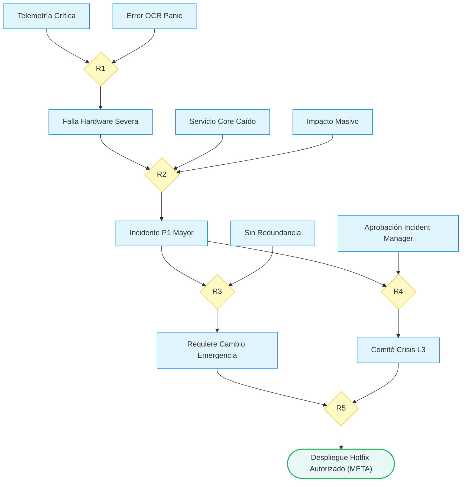

# Semana 13: Motor de Inferencia Determinista para Incidentes Críticos ITIL

## 1. Propósito y Contexto Simple
En la administración de infraestructura de TI y centros de datos, autorizar un **cambio de emergencia (P1)** directamente en producción es una decisión de máximo riesgo operativo. Si un servidor crítico de pagos falla, no podemos confiar en predicciones aproximadas de Machine Learning:

> **La metáfora del avión y la bóveda bancaria:**  
> Un piloto no aterriza diciendo *"hay un 95% de probabilidad de que el tren de aterrizaje haya bajado"*, ni un oficial bancario abre una bóveda porque un modelo predice al *"92% de confianza que es el gerente"*. En operaciones de misión crítica se exige **certeza demostrada al 100% y trazabilidad paso a paso**.

A lo largo del proyecto, la arquitectura corporativa ha evolucionado integrando capacidades complementarias:
- **Clasificador de Tickets (Semana 02):** Triaje inicial de solicitudes mediante Machine Learning supervisado.
- **Taxonomía Explicable XAI (Semana 03):** Mapeo simbólico de tickets hacia ramas de inteligencia artificial.
- **Planificador de Rutas Óptimas A* (Semana 04):** Búsqueda heurística en grafos de resolución ITIL.
- **Sistema Híbrido RAG (Semana 05):** Recuperación de procedimientos técnicos con guardrail de contención al 20%.
- **Telemetría y Autómata DFA (Semana 07):** Monitoreo continuo de CPU, RAM y temperatura con autómatas finitos.
- **Visión Artificial y OCR (Semana 09):** Extracción de códigos de volcado de memoria en capturas de pantalla de error.
- **Evaluación y Benchmarking (Semana 11):** Selección rigurosa del modelo óptimo de triaje rutinario.
- **Motor de Conocimiento (Semana 13):** Cúspide de razonamiento lógico formal para autorizar pases de emergencia con cero margen de duda.

```text
EVOLUCIÓN ARQUITECTÓNICA DEL SISTEMA
Semana 02: Triaje supervisado con Machine Learning
    ↓
Semana 07: Sensores de telemetría en tiempo real (CPU, RAM, Temp)
    ↓
Semana 09: Visión artificial y OCR para capturas de pantalla
    ↓
Semana 13: Cúspide de decisión lógica determinista (Reglas Horn ITIL)
```

---

## 2. Conceptos Clave en Palabras Simples
- **Hechos (Átomos proposicionales):** Afirmaciones atómicas que solo pueden ser verdaderas o falsas (ej. *"¿hay telemetría crítica?", "¿firmó el Incident Manager?"*).
- **Reglas Horn:** Enunciados de la forma *"Si se cumple A y B, entonces se deduce C"*. Poseen una única conclusión positiva, eliminando ambigüedades.
- **Encadenamiento hacia adelante (*Forward Chaining*):** Razonamiento deductivo similar a un detective: partimos de las pistas conocidas y disparamos reglas consecutivamente hasta alcanzar la meta.
- **Principio de Mundo Abierto (*Open World Assumption*):** Si una evidencia no está registrada en el ticket, el sistema no la considera falsa ni deniega el cambio; simplemente dictamina que **aún no ha sido demostrada con los hechos disponibles**.

---

## 3. Las 5 Reglas del Negocio y el Flujo
El motor evalúa 5 reglas clave de gobernanza ITIL:

| Regla | Premisas Requeridas | Conclusión Deducida | Significado Operativo |
|---|---|---|---|
| **R1** | `telemetria_critica_confirmada` $\wedge$ `error_kernel_panic_ocr` | `falla_hardware_severa` | Sensores y OCR confirman daño físico irreversible. |
| **R2** | `falla_hardware_severa` $\wedge$ `servicio_core_afectado` $\wedge$ `impacto_usuarios_masivo` | `incidente_p1_mayor` | La falla tumba el negocio central afectando a clientes. |
| **R3** | `incidente_p1_mayor` $\wedge$ `sin_redundancia_activa` | `requiere_cambio_emergencia` | Sin servidor de respaldo, no se puede posponer el arreglo. |
| **R4** | `incidente_p1_mayor` $\wedge$ `aprobacion_incident_manager` | `activacion_comite_crisis_l3` | El gestor autoriza convocar a especialistas Nivel 3. |
| **R5** | `requiere_cambio_emergencia` $\wedge$ `activacion_comite_crisis_l3` | `despliegue_hotfix_autorizado` | **Meta final:** Luz verde para aplicar el parche en caliente. |



---

## 4. Implementación en Código
El Motor de Inferencia Lógica implementa estructuras inmutables y evaluación de conjuntos pura sin librerías pesadas:

**1. Definición Inmutable de la Regla:**
```python
@dataclass(frozen=True)
class Regla:
    nombre: str
    premisas: frozenset[str]
    conclusion: str
```

**2. Algoritmo de Encadenamiento hacia Adelante:**
```python
while cambios:
    cambios = False
    for regla in reglas:
        if regla.premisas.issubset(hechos) and regla.conclusion not in hechos:
            hechos.add(regla.conclusion)
            trazas.append(f"{regla.nombre}: {', '.join(sorted(regla.premisas))} => {regla.conclusion}")
            cambios = True
```

**3. Interfaz de Evaluación para Servicios:**
```python
def evaluar_caso_soporte(hechos_iniciales: set[str], meta: str = "despliegue_hotfix_autorizado") -> dict[str, Any]:
    hechos_finales, trazas = inferir(hechos_iniciales, construir_reglas())
    demostrada = meta in hechos_finales
    return {"hechos": sorted(list(hechos_finales)), "trazabilidad": trazas, "demostrada": demostrada}
```

---

## 5. Casos de Estudio Operativo

### Caso A: Evidencia Técnica y Administrativa Completa
Se suministran los 6 hechos iniciales del incidente. El motor evalúa el grafo deductivo y dispara la cadena completa:
```text
R1: error_kernel_panic_ocr, telemetria_critica_confirmada => falla_hardware_severa
R2: falla_hardware_severa, impacto_usuarios_masivo, servicio_core_afectado => incidente_p1_mayor
R3: incidente_p1_mayor, sin_redundancia_activa => requiere_cambio_emergencia
R4: aprobacion_incident_manager, incidente_p1_mayor => activacion_comite_crisis_l3
R5: activacion_comite_crisis_l3, requiere_cambio_emergencia => despliegue_hotfix_autorizado
Veredicto: DEMOSTRADA (Pase a producción concedido)
```

### Caso B: Falta Aprobación del Incident Manager
Se reporta la falla física completa pero se omite la firma gerencial. El motor se detiene de forma preventiva:
```text
R1: error_kernel_panic_ocr, telemetria_critica_confirmada => falla_hardware_severa
R2: falla_hardware_severa, impacto_usuarios_masivo, servicio_core_afectado => incidente_p1_mayor
R3: incidente_p1_mayor, sin_redundancia_activa => requiere_cambio_emergencia
Veredicto: NO DEMOSTRADA con los hechos disponibles (Bloqueo de seguridad preventivo)
```

---

## 6. Validación y Suite de Pruebas Unitarias
La Suite de Pruebas Unitarias contiene 11 pruebas automatizadas que certifican la fiabilidad industrial del motor:
- **Seguridad y Bloqueo:** Validación rigurosa de que la falta de firmas impida pases a producción indebidos.
- **Inmunidad a Bucles Infinitos:** Terminación determinista garantizada ante dependencias circulares y reglas duplicadas.
- **Inmutabilidad de Datos:** Protección estricta contra manipulaciones accidentales en memoria (`FrozenInstanceError`).
- **Latencia Ultra Baja:** El motor resuelve inferencias en menos de **0.01 ms** (promedio de 0.0094 ms en ráfagas de 1.000 ejecuciones), superando con creces el límite máximo de SLA de 5 ms.

---

## 7. Conclusiones
1. **Gobernanza y Certeza:** La lógica Horn determinista aporta la capa de rigor inquebrantable requerida para incidentes críticos donde el margen de error estadístico es intolerable.
2. **Arquitectura Complementaria:** El sistema corporativo logra su máxima robustez combinando Machine Learning para triaje masivo de texto, visión artificial para telemetría visual y razonamiento lógico para la decisión ejecutiva final.
3. **Auditabilidad y Velocidad:** Cada autorización cuenta con una bitácora explicativa paso a paso generada en microsegundos, asegurando cumplimiento regulatorio inmediato.
