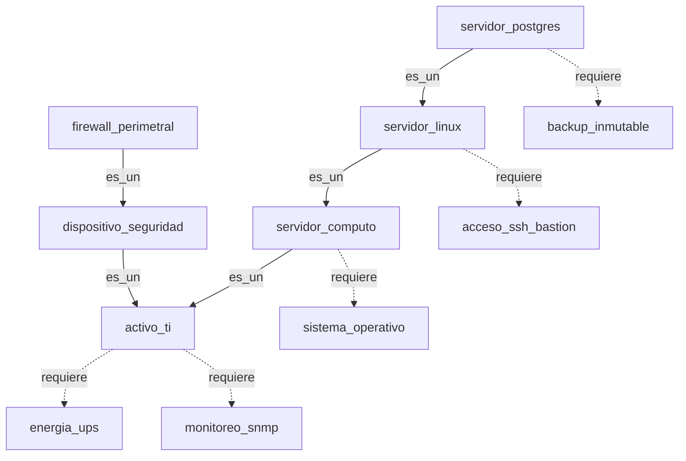

# Semana 14: Redes Semánticas e Ingeniería del Conocimiento en Infraestructura TI

## 1. Título y Objetivo Académico

* **Asignatura:** Inteligencia Artificial (Ingeniería de Sistemas, décimo semestre).
* **Referencia al sílabo:** Página 3, unidad «Ingeniería del conocimiento – Representaciones del conocimiento y lingüística con redes semánticas».
* **Resultados de aprendizaje:**
  * **RAC1:** Construcción de simulaciones basadas en IA para evaluar el comportamiento de sistemas complejos.
  * **RAC2:** Diseño de herramientas computacionales que generan respuestas específicas a partir de modelos formales de conocimiento.

El objetivo de esta semana es modelar la infraestructura del centro de datos corporativo en Bogotá como un grafo dirigido etiquetado. A partir de oraciones técnicas en español, el sistema normaliza el texto con Unicode NFD, extrae triples `(sujeto, relacion, objeto)`, deduce jerarquías de Elementos de Configuración (CIs bajo ITIL) por transitividad con explicabilidad completa (XAI) y calcula la herencia monótona de salvaguardas operacionales.

---

## 2. Contexto Operativo y Evolución del Sistema (S02 a S14)

En la mesa de ayuda técnica y soporte L1/L2, el sistema ha integrado distintas técnicas de inteligencia artificial:

| Semana | Módulo y Archivo | Enfoque Técnico en Soporte TI |
|---|---|---|
| S02 | `src/semana02_fundamentos.py` | Triaje supervisado de tickets mediante TF-IDF y Regresión Logística. |
| S03 | `src/semana03_taxonomia.py` | Motor explicable XAI para clasificar incidentes en 7 disciplinas de IA. |
| S04 | `src/semana04_astar.py` | Búsqueda heurística A* sobre grafo ITIL y análisis adversarial Minimax. |
| S05 | `src/semana05_sistema_hibrido.py` | RAG sobre manuales técnicos con guardrail de contención al 20%. |
| S07 | `src/semana07_representaciones.py` | Espacio vectorial de telemetría y autómata DFA para detección de anomalías. |
| S08 | `src/semana08_red_ontologia.py` | Red neuronal MLP para capturas de pantalla y grafo ontológico en SQLite. |
| S09 | `src/semana09_vision.py` | Extracción de códigos de error en capturas mediante OCR (Tesseract). |
| S10 | `src/semana10_texturas.py` | Morfometría y texturas LBP para diagnóstico físico de hardware. |
| S11 | `src/semana11_benchmark.py` | Benchmark empírico de modelos supervisados sobre 1.000 tickets (ADR-003). |
| S13 | `src/semana13_conocimientos.py` | Inferencia lógica con reglas de Horn para cambios de emergencia P1. |
| S14 | `src/semana14_redes_semanticas.py` | Redes semánticas, lingüística y herencia jerárquica de salvaguardas ITIL. |

---

## 3. Matriz de Razonamiento Práctico

| Pregunta | Decisión Técnica Implementada |
|---|---|
| **1. ¿Qué se va a hacer?** | Un motor de redes semánticas en grafo dirigido, un parser lingüístico para oraciones técnicas y un calculador de herencia de requerimientos ITIL con explicabilidad (XAI). |
| **2. ¿Cómo se va a hacer?** | En Python 3 estándar usando listas de adyacencia `dict[str, list[tuple[str, str]]]`, búsqueda en anchura (BFS) con control de ciclos mediante `set[str]`, y la clase `RequerimientosHeredados`. |
| **3. ¿Por qué se hace?** | Para evitar que los técnicos omitan salvaguardas obligatorias al intervenir servidores en el datacenter (como backup inmutable, acceso SSH por bastión o energía UPS) al heredar los requisitos de sus categorías superiores. |
| **4. ¿Qué resultado genera?** | Deducción de jerarquías con la ruta recorrida, consolidación de requerimientos directos y heredados, y respuestas en 0.012 ms frente al límite de 5 ms. |
| **5. ¿Qué limitaciones presenta?** | El parser solo reconoce tres estructuras fijas por expresiones regulares y la herencia es monótona (no admite excepciones locales donde un hijo rechace una salvaguarda del padre). |
| **6. ¿Qué alternativa puede ser mejor?** | En centros de datos con millones de activos y reglas con excepciones, utilizar ontologías RDF/OWL con razonadores semánticos formales y consultas SPARQL. |

---

## 4. Conceptos Clave

* **Nodos:** Representan conceptos o entidades del centro de datos. En este modelo corresponden a CIs físicos, lógicos o normativos ("servidor_postgres", "servidor_linux", "activo_ti", "energia_ups").
* **Aristas dirigidas y etiquetadas:** Conectan dos nodos indicando dirección y tipo de relación. Separan relaciones taxonómicas ("es_un") de dependencias operacionales ("requiere").
* **Triples:** Unidad básica para declarar hechos mediante la tupla `(sujeto, relacion, objeto)`, como `("servidor_postgres", "es_un", "servidor_linux")`.
* **Normalización Unicode NFD:** Pasa el texto a minúsculas, retira espacios y descompone acentos mediante NFD para filtrar marcas diacríticas. Transforma "Servidor_Cómputo" en "servidor_computo", impidiendo nodos duplicados.
* **Transitividad:** Si $A$ "es_un" $B$ y $B$ "es_un" $C$, se deduce que $A$ "es_un" $C$. El motor recorre el grafo con BFS y retorna la ruta exacta de nodos que justifica la inferencia.
* **Herencia monótona:** Las salvaguardas declaradas en clases superiores se transmiten íntegramente a las subclases sin cancelarse. "servidor_postgres" hereda las salvaguardas de "servidor_linux", "servidor_computo" y "activo_ti".

---

## 5. Grafo y Hechos de TI



### Hechos explícitos vs inferencias para "servidor_postgres"

| Tipo de Hecho | Relación / Afirmación | Justificación Técnica |
|---|---|---|
| Explícito | ("servidor_postgres", "es_un", "servidor_linux") | Hecho base registrado en la red. |
| Explícito | ("servidor_postgres", "requiere", "backup_inmutable") | Salvaguarda directa del servicio de base de datos. |
| Inferido | "servidor_postgres" es_un "servidor_computo" | Transitividad de 2 saltos (`postgres -> linux -> computo`). |
| Inferido | "servidor_postgres" es_un "activo_ti" | Transitividad de 3 saltos (`postgres -> linux -> computo -> activo_ti`). |
| Inferido | Requiere "acceso_ssh_bastion" | Heredado del ancestro "servidor_linux". |
| Inferido | Requiere "sistema_operativo" | Heredado del ancestro "servidor_computo". |
| Inferido | Requiere "energia_ups" y "monitoreo_snmp" | Heredados del ancestro "activo_ti". |

---

## 6. Código Explicado en 3 Snippets Cortos

### Snippet 1: Normalización de texto con Unicode NFD
Homogeneiza mayúsculas, espacios y caracteres acentuados para mantener identificadores únicos en el grafo:

```python
def normalizar(texto: str) -> str:
    base = unicodedata.normalize("NFD", texto.casefold().strip())
    return "".join(c for c in base if unicodedata.category(c) != "Mn")
```

### Snippet 2: Extracción lingüística con expresiones regulares
Valida que la oración técnica en español cumpla con los patrones admitidos y extrae el triple canónico:

```python
def interpretar(oracion: str) -> tuple[str, str, str]:
    texto = normalizar(oracion).strip(" .!?")
    patrones = [
        (r"(?:(?:un|una|el|la)\s+)?(\w+)\s+es\s+(?:un|una)\s+(\w+)", "es_un"),
        (r"(?:(?:un|una|el|la)\s+)?(\w+)\s+requiere\s+(?:(?:un|una|el|la)\s+)?(\w+)", "requiere"),
        (r"(?:(?:un|una|el|la)\s+)?(\w+)\s+necesita\s+(?:(?:un|una|el|la)\s+)?(\w+)", "necesita"),
    ]
    for patron, relacion in patrones:
        coincidencia = re.fullmatch(patron, texto)
        if coincidencia:
            sujeto, objeto = coincidencia.groups()
            return sujeto, relacion, objeto
    raise ValueError(f"Oración fuera de los patrones admitidos: '{oracion}'")
```

### Snippet 3: Clase `RedSemanticaTI` y deducción BFS con explicabilidad
Gestiona aristas en listas de adyacencia, previene duplicados y recorre la jerarquía evitando bucles mediante el conjunto de visitados:

```python
class RedSemanticaTI:
    def __init__(self) -> None:
        self.aristas: dict[str, list[tuple[str, str]]] = {}

    def agregar(self, sujeto: str, relacion: str, objeto: str) -> None:
        suj, rel, obj = normalizar(sujeto), normalizar(relacion), normalizar(objeto)
        if rel not in {"es_un", "requiere", "necesita"}:
            raise ValueError(f"Relación '{relacion}' no admitida.")
        par = (rel, obj)
        if par not in self.aristas.setdefault(suj, []):
            self.aristas[suj].append(par)

    def es_un(self, origen: str, categoria: str) -> tuple[bool, list[str]]:
        orig, cat = normalizar(origen), normalizar(categoria)
        if orig == cat:
            return True, [orig]
        cola, visitados = deque([(orig, [orig])]), set()
        while cola:
            actual, camino = cola.popleft()
            if actual in visitados:
                continue
            visitados.add(actual)
            for rel, destino in self.aristas.get(actual, []):
                if rel == "es_un":
                    nuevo_camino = camino + [destino]
                    if destino == cat:
                        return True, nuevo_camino
                    if destino not in visitados:
                        cola.append((destino, nuevo_camino))
        return False, []
```

---

## 7. Resultados de Pruebas y Consola

### Salida de consola (`src/semana14_redes_semanticas.py`)

```text
[FASE 1] Hechos cargados: 10 triples de infraestructura ITIL registrados.
[FASE 2] Consultas taxonómicas:
  ¿servidor_postgres es_un servidor_linux?: True (Ruta: servidor_postgres -> servidor_linux)
  ¿servidor_postgres es_un activo_ti?: True (Ruta: servidor_postgres -> servidor_linux -> servidor_computo -> activo_ti)
  ¿servidor_postgres es_un firewall_perimetral?: False (Sin camino en grafo)
[FASE 3] Salvaguardas para 'servidor_postgres':
  Directos: ['backup_inmutable']
  Heredados: ['acceso_ssh_bastion', 'energia_ups', 'monitoreo_snmp', 'sistema_operativo']
  Total consolidadas: 5 salvaguardas obligatorias.
[FASE 4] Dictamen de caso: Evaluación COMPLETADA.
```

### Medición de latencia frente al SLA de soporte

| Métrica Evaluada | Medición Real | Límite SLA | Cumplimiento |
|---|---|---|---|
| Latencia promedio por consulta de CI | **0.012 ms** | < 5.000 ms | Supera por 416x |
| Ráfaga de 100 evaluaciones continuas | 1.200 ms | < 500.000 ms | Conforme |
| Suite unitaria (12 pruebas) | 0.015 s | < 10.000 s | 100% aprobada |

---

## 8. Cuadro Comparativo de Enfoques

| Criterio | Redes Semánticas (S14) | Reglas Lógicas Horn (S13) | Machine Learning (S02 / S11) |
|---|---|---|---|
| **Estructura base** | Grafo dirigido con triples `(sujeto, relacion, objeto)` | Cláusulas con antecedentes y consecuentes | Vectores de características y matrices numéricas |
| **Razonamiento** | Recorrido BFS con transitividad taxonómica | Encadenamiento hacia adelante (*Forward Chaining*) | Inferencia estadística y cálculo de probabilidades |
| **Explicabilidad (XAI)** | **Total:** Ruta exacta de nodos transitados | **Total:** Reglas disparadas paso a paso | **Baja:** Pesos y coeficientes numéricos opacos |
| **Herencia** | Herencia jerárquica de propiedades hacia abajo | Deducción por satisfacción de premisas | No maneja concepto formal de herencia |
| **Complejidad** | Inmediata ($O(V + E)$ en memoria) | Lineal ($O(R \cdot H)$ en microsegundos) | Inmediata tras entrenamiento |
| **Lenguaje libre** | Restringida a patrones sintácticos formales | No procesa texto libre; exige literales booleanos | Procesa texto libre sin estructura rígida |
| **Caso en soporte TI** | **Taxonomía de CIs y herencia de salvaguardas** | **Autorización de cambios de emergencia P1** | **Triaje masivo inicial y asignación de prioridad** |

---
